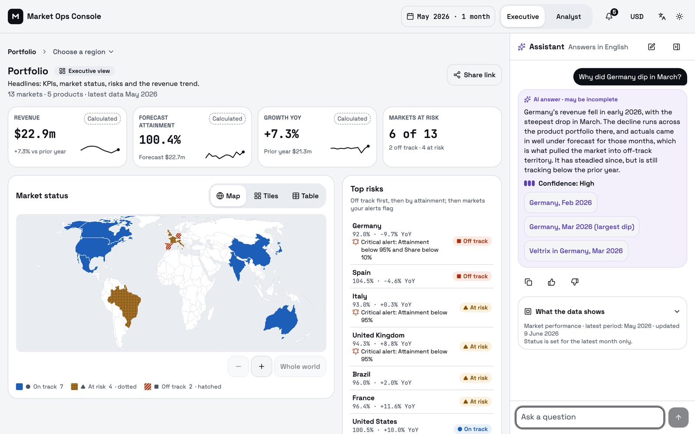
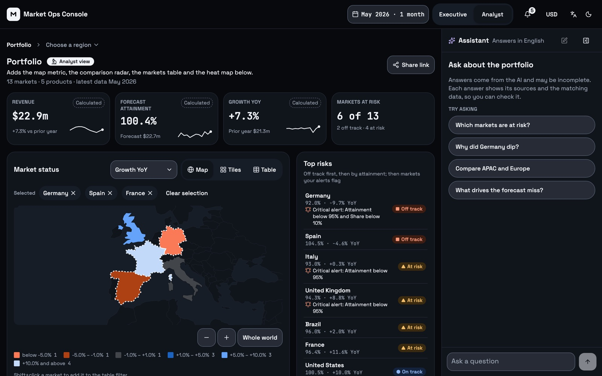
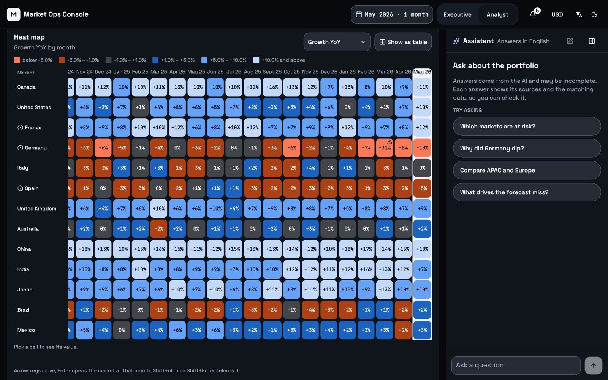
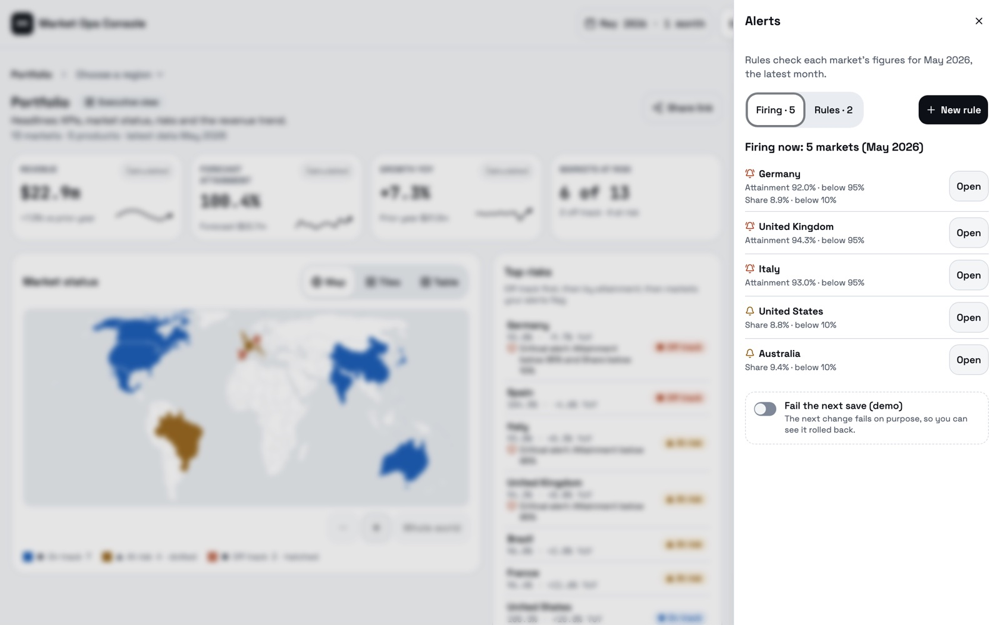
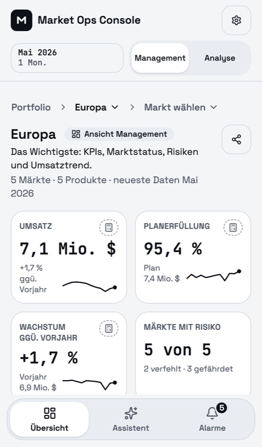
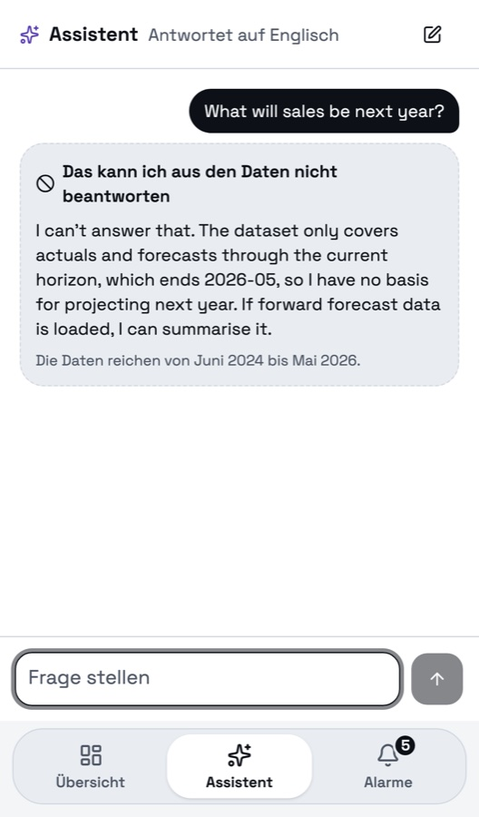
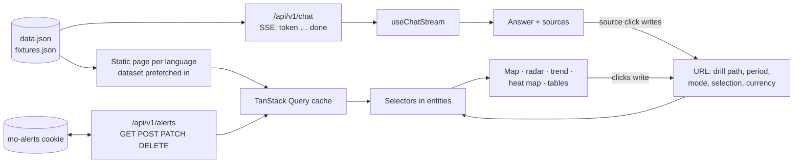

# Market Ops Console

> **From the author.** Although this project was made with the help of AI, a person put a lot into it: effort, time, experience and research. Even if something you wanted was not implemented, it is no problem at all to add it. I would just really like to talk and to hear your feedback personally. *(In my own words, said in Ukrainian and translated into English.)*

A console for a commercial operations team. Two surfaces over one dataset:

- a **streaming AI assistant** that cites its sources, says how sure it is, and says so when the data cannot answer;
- an **analytical dashboard** (map, radar, time series, heat map) with drill-down from portfolio to product.

Take-home assignment for the Frontend Engineer role at NewPage Solutions.

**Live:** https://df-market-ops-console.vercel.app · **Every brief requirement, where it is and how to check it:** [`docs/requirements-map.md`](docs/requirements-map.md) · **Full feature list:** [`docs/features.md`](docs/features.md)

## A few words from me

> **About the language.** English is not my first language, and I am not fluent yet. The parts of this README marked *In my own words* I said in Ukrainian, and they were translated into English with an AI tool, as close to word for word as possible. The AI only translated what I said; it did not write it for me. These are my thoughts and my feelings.
>
> It was a very interesting product. Of course, quite a big one. But I really enjoyed building it, and I got carried away by it. It was very nice to have this opportunity. I hope we get to meet and talk more. If you have any feedback at all, I will be glad to hear it, because I really put a lot of effort and time into this.

| | |
|---|---|
|  |  |
| Executive view. The answer is marked as AI, shows its confidence and one button per source. | Analyst view, dark theme. Markets picked on the map narrow the radar and the table. |
|  |  |
| Heat map, markets × months. Germany's March 2026 dip (−31 %) is marked with a warning sign. | Alerts: what fires now, the rules, and a switch that fails the next save to show the rollback. |

<p>
  
  
</p>

Phone, in German: the Europe overview, and the assistant refusing a question the data cannot answer.

## Contents

1. [A few words from me](#a-few-words-from-me)
2. [Try it in three minutes](#try-it-in-three-minutes)
3. [Quick start](#quick-start)
4. [Architecture](#architecture)
5. [Front-end approach and decisions](#front-end-approach-and-decisions)
6. [Making the AI output trustworthy](#making-the-ai-output-trustworthy)
7. [Productionising it](#productionising-it)
8. [Accessibility](#accessibility)
9. [Testing](#testing)
10. [Key technical decisions](#key-technical-decisions)
11. [Engineering standards](#engineering-standards)
12. [How I used AI tools](#how-i-used-ai-tools)
13. [What I like in it](#what-i-like-in-it)
14. [What I'd do differently with more time](#what-id-do-differently-with-more-time)
15. [Repository map](#repository-map)

## Try it in three minutes

1. **Ask.** In the assistant, pick "Why did Germany dip?". The answer streams word by word. Ask "Give me a full summary of the portfolio" and press Stop to cut a long one.
2. **Check it.** Hover a source button: the card shows the real numbers. Click it: the dashboard opens Germany in that month. Open "What the data shows" under the answer: the same facts from the dataset, with no AI involved.
3. **Hit the edges.** "What will sales be next year?" is refused. "Compare APAC and Europe" comes back with medium confidence. "force error" fails and offers Try again.
4. **Drill and share.** Click Germany on the map, then pick a product in the path above the title. Press Back and Forward. Press Share link and open the link in another browser: the same view opens.
5. **Analyst.** Switch to Analyst. Shift+click Spain and France on the map: the radar and the markets table follow. Find Germany's March 2026 cell in the heat map.
6. **Alerts.** Open the bell. Add a rule "Growth below 0 %" and watch the preview list the markets it would flag. Tick "Fail the next save (demo)", switch a rule off, and watch it come back with the reason and Retry.
7. **Settings.** Switch the currency to EUR (every amount converts, percentages stay), the language to Deutsch, the theme to dark.

## Quick start

Node 24 (`.nvmrc`) and pnpm 10.

```bash
pnpm install
cp .env.example .env.local   # optional; the defaults work
pnpm dev                     # http://localhost:3000
```

| Command | What it does |
|---|---|
| `pnpm build && pnpm start` | Production build; pages are static, one per language |
| `pnpm lint` | ESLint and Steiger (architecture boundaries) |
| `pnpm typecheck` | TypeScript, strict |
| `pnpm test` | Unit and component tests (Vitest) |
| `pnpm exec playwright install chromium` | Once, before the first E2E run |
| `pnpm e2e` | Builds, starts on :3100 and runs Playwright (desktop and phone); a dev server on :3000 can keep running |
| `pnpm format` | Prettier |

## Architecture

**One Next.js app** (App Router), organised by **Feature-Sliced Design**: each layer imports only from the layers below it, and Steiger fails the lint when one doesn't ([ADR 0005](docs/decisions/0005-feature-sliced-design.md)).

| Layer | What lives there | Examples |
|---|---|---|
| `app/` | Routing only: each page re-exports a page from `src/pages` | `app/[locale]/dashboard`, `app/api/v1/chat` |
| `src/pages` | Composition, no logic | `dashboard` |
| `src/widgets` | Screen blocks | `assistant-panel`, `market-status`, `heat-map`, `alerts-panel` |
| `src/features` | User actions | `ask-question`, `drill-down`, `configure-alerts`, `export-markets` |
| `src/entities` | Business data and its calculations | `performance` (KPIs, statuses, URL state), `alert-rule` |
| `src/shared` | No business knowledge | UI kit, HTTP and SSE client, formatters, Sentry helpers |

**How data moves:**



The URL is the single source of what is on screen. A click on the map, a source in an answer, the period picker: each writes the URL, and every widget reads from it. That is why Back, Forward and a shared link just work.

**Server state vs client state** ([ADR 0006](docs/decisions/0006-state-and-url.md)):

| State | Where it lives | Why |
|---|---|---|
| Dataset, alert rules | TanStack Query | Server data: cached, refetched, written optimistically |
| Drill path, period, mode, selection, metric, sort, currency, tab | URL (nuqs) | Shareable; Back and Forward work |
| The chat | `useReducer` in `useChatStream`, copied to `sessionStorage` | Survives a reload, ends with the tab |
| Theme, map or tiles, chart or table, collapsed assistant | `localStorage` | A per-browser preference, not part of a shared link |
| Open menus, hover, the alert form's draft | `useState`, react-hook-form | Lives and dies with the component |

No Redux or Zustand: these tools cover every case.

## Front-end approach and decisions

| Area | Considered | Picked | Why |
|---|---|---|---|
| Framework | Remix, TanStack Start | **Next.js 16, App Router** | Static pages per language, route handlers for the mock API, Vercel. The others offered nothing here that Next doesn't |
| Components and tokens | MUI, Chakra | **Tailwind v4 + shadcn/ui (Radix)** | The source is in the repo, so the tokens are ours. Radix gives accessible menus and dialogs. Tokens live in `globals.css`; a test forbids raw colours ([DESIGN.md](DESIGN.md)) |
| Streaming | Vercel AI SDK, `fetch-event-source`, `EventSource` | **`fetch` + `ReadableStream` + `eventsource-parser`** | `EventSource` cannot POST. The AI SDK expects its own protocol, not the brief's contract. Every event is checked by a zod schema; Stop is an `AbortController` ([ADR 0003](docs/decisions/0003-chat-streaming.md)) |
| Charts | ECharts, Nivo, Highcharts, own d3 | **Recharts** (shadcn charts) for trend and radar, **react-simple-maps** for the map, **an HTML table** for the heat map | Each fits its chart. The heat map is a grid of buttons, so arrow keys and screen readers come almost free ([ADR 0004](docs/decisions/0004-data-visualisation.md)) |
| Server state | SWR | **TanStack Query** | A better story for optimistic writes and rollback |
| URL state | hand-written `useSearchParams` | **nuqs** | Typed parameters that behave like `useState` |
| Coordinated views | React context or a global store for the selection | **The URL as the only source** of path, period, selection and mode | Every view reads it, every click writes it: a selection on the map narrows the table and the radar, and the same view comes back on Back, Forward or a shared link ([ADR 0006](docs/decisions/0006-state-and-url.md)) |
| Forms | Formik | **react-hook-form + zod** | One zod schema checks both the form and the API route |
| i18n | `Intl` only, react-i18next | **next-intl** | Typed keys and one formatter for server and browser, so pages stay static ([ADR 0010](docs/decisions/0010-i18n-and-locale.md)) |

Every choice, with what was rejected: [ADR 0002](docs/decisions/0002-stack.md).

## Making the AI output trustworthy

- **AI looks different.** AI text sits on its own violet surface, labelled "AI answer · may be incomplete". Numbers from the dataset never use that surface.
- **Every claim can be checked.** One button per source. Hover shows the real figures and a 12-month trend; a click moves the dashboard there. Sources are per answer, not per sentence: the contract has no positions in the text, and guessing them would mean parsing AI text.
- **"What the data shows"** under each answer is built from the dataset by fixed rules, not by the AI: the cited rows, the portfolio row, and markets the answer didn't mention.
- **Confidence is honest.** A meter and a word. Low adds "Treat as directional".
- **Refusal is a state of its own**, with its own frame and a line on what the data does cover.
- **Safe rendering.** Answers render as plain text, never as HTML.

## Productionising it

**Performance.** Pages are pre-rendered per language and served from Vercel's CDN. Heavy parts load only when needed: the map (~71 KB gz), the charts, and ExcelJS (~250 KB gz, only when Export is clicked). **Streaming without jank.** The chat's state lives in the assistant panel, so tokens re-render only the answer being written, never the dashboard. The list follows the answer only while the reader is at the bottom; if they scrolled up, a "New content" button appears instead of the page jumping. "What the data shows" is worked out once, when the answer ends. Lighthouse on production (0.15.0):

| | Performance | Accessibility | Best practices | LCP | TBT | CLS |
|---|---|---|---|---|---|---|
| Desktop | 99 | 100 | 100 | 1.0 s | 0 ms | 0.02 |
| Mobile (slow 4G, 4× CPU) | 68 | 100 | 100 | 5.5 s | 450 ms | 0 |

Mobile LCP is the weak spot: most of it is JavaScript parsing on a slow CPU. What would fix it is in the [backlog](docs/plans/backlog.md).

### Observability

Sentry ([ADR 0019](docs/decisions/0019-error-monitoring-sentry.md)): errors from the browser and the server, traces (10 % in production), web vitals, and console logs. Two user paths are timed: the chat answer (time to the first token and to the end) and the Excel export. Every event is tagged with language, mode, currency and tab. All reporting goes through one place (`logError`, `logWarning`, `logEvent`); lint blocks a direct Sentry import. Expected failures, such as a name already taken, are breadcrumbs, not issues.

Sentry gets no IP address, no cookies, no headers, no request bodies, and never the question text. Events go through our own `/monitoring` route, which forwards only the event body. It reports from Vercel only (`production`, `preview`); on a developer's machine it is off unless `NEXT_PUBLIC_SENTRY_LOCAL=true`. A test page, `/sentry-test`, fires each kind of error; it exists only where `ENABLE_SENTRY_TEST_PAGE=true` is set in `.env.local`, and is a 404 everywhere else.

**Before a real launch for UK or EU users** (UK GDPR and PECR, EU GDPR and ePrivacy): a cookie and consent banner, a privacy notice that names Sentry, Sentry's data processing agreement, and a Sentry organisation in the EU region (this demo's is in the US). Details are in ADR 0019. This is a summary, not legal advice.

### Resilience

- An error boundary per widget: one broken chart doesn't take the page down.
- Timeouts and typed errors on every request ([ADR 0012](docs/decisions/0012-api-versioning-and-resilience.md), [ADR 0013](docs/decisions/0013-error-handling.md)).
- An offline screen that keeps the app mounted underneath, so the chat and a form draft survive.
- 404 and 500 pages in the app's look, in every language.
- A broken link (an unknown market, a bad period) is corrected in place, not shown as an error.

### CI/CD

GitHub Actions, on pull requests only, one check per job ([ADR 0007](docs/decisions/0007-git-flow-and-ci.md)):

| Pull request into | Checks |
|---|---|
| `release/*` | Format, lint, types |
| `develop` | Branch and version, then in parallel: format, lint, types, unit tests, E2E |
| `master` | Branch and version |

Vercel builds previews and deploys `master` to production. Branches go `feature/X.Y.Z/name` → `release/X.Y.Z` → `develop` → `master`.

## Accessibility

*In my own words:*

> About people, I thought like this: the most important thing I put in was that it is convenient for them. I applied the best practices, both for those who have different needs and for everyone else, but overall so that it all works, and works conveniently. For the users I added different languages, different currencies, different themes, so that it is convenient for them to work, and also different hints and so on, so that all of this makes the work better and helps them find their way faster in what is there.
>
> I checked the whole site: the map, the assistant, the menus, the dashboard. For accessibility, I have not turned on voice reading (a screen reader) yet; I am going to do it now and check that it all works well for people. But overall I checked it, because I would really like it to be well supported, and for everyone to be able to use this product comfortably, at any time, in any place, and whatever a person's abilities are.

Target: WCAG 2.1 AA, checked against 2.2 where it was cheap.

- **Keyboard everywhere.** The map's countries are focusable, with zoom buttons. The heat map is an ARIA grid with arrow keys. Menus and sheets keep focus inside and give it back when they close.
- **Every chart has a table.** "Show as table" on each; the choice is remembered.
- **Not colour alone.** Status has a colour, a shape and a pattern (dotted, hatched). Chart colours were checked with a colour-blindness and contrast validator.
- **Screen readers.** A streaming answer is marked busy, so it is read when it ends, not word by word. The visible text of a button is part of its name.
- **Reduced motion** stops the chart animations, the pulsing skeletons and smooth scrolling.
- **Checked by** axe in E2E (WCAG 2.1 A/AA, desktop and phone, no exclusions), and by hand with the keyboard.
- **Would add:** a real screen-reader pass (VoiceOver, NVDA) and a 200 % zoom check on every screen.

## Testing

| Kind | Tool | What |
|---|---|---|
| Unit and component | Vitest, Testing Library, MSW: 147 files, 960 tests | SSE parsing, schemas, selectors, formatters; streaming, Stop, refusal, low confidence and error; sources; drill-down into the URL; alert validation and rollback; the charts' tables |
| End-to-end | Playwright, 60 tests, desktop and phone | The brief's happy path (map → Germany → ask → a source opens the month), Back and Forward, shared links, alerts on the real API, exports as real downloads, offline, axe scans, and what Sentry would send |

A new test for a bug has to fail on the code before the fix; it is run against the old code to prove that.

**Skipped on purpose:** visual regression (fonts and OS make screenshots flaky), a cross-browser matrix (CI minutes), Storybook ([ADR 0008](docs/decisions/0008-testing-scope.md)).

## Key technical decisions

- **Static pages, URL read on the client.** Every page is pre-rendered per language, and the view is drawn from the URL after load. A skeleton holds its place, so a shared link never flashes the default view first. The cost is mobile LCP (above).
- **Two modes for two audiences.** Executive shows the headlines: KPIs, market status, top risks, top movers, the trend. Analyst adds the map metric, the markets table with export, the radar and the heat map. The mode is one URL parameter, so a shared link opens the same audience's view.
- **The mock API is a cookie, not a server.** The brief says not to build a backend. Alert rules live in a cookie behind real `GET / POST / PATCH / DELETE` routes, so the optimistic save and rollback run over a real network round trip ([ADR 0016](docs/decisions/0016-alert-writes.md)).
- **Alert writes go one at a time.** The cookie holds the whole list, so two writes in flight would overwrite each other. The screen still updates at once.
- **Chat history in `sessionStorage`.** It survives a reload and ends with the tab. `localStorage` would leave a transcript on a shared computer. Production would keep threads on the server, per user.
- **Currency at fixed rates.** The data is in USD; EUR and GBP use the ECB rates of 5 November 2026, fixed in the code. One rate for every month, so percentages never change ([ADR 0017](docs/decisions/0017-currency-display.md)).
- **No flash before hydration.** Theme, mode and the collapsed panel are set by a small script in `<head>` before the first paint ([ADR 0015](docs/decisions/0015-persisted-ui-state-before-paint.md)).

## Engineering standards

**Followed**
- Strict TypeScript, no `any`, no type casts except `as const`.
- Every visible word comes from the dictionaries (English, German, Russian); lint fails on a literal string in the UI.
- Design tokens only; a test fails on a raw colour.
- Architecture boundaries enforced by Steiger.
- Environment variables only through one validated module.
- No experimental Next.js flags.
- One record per decision ([`docs/decisions`](docs/decisions)); deferred review findings in [`docs/plans/backlog.md`](docs/plans/backlog.md).

**Skipped**
- Git hooks (husky): CI does the checking.
- Branch protection: not available on a free private repo.
- Storybook and visual regression (above).
- Rate limiting: it belongs on the server, per user or IP. The mock API caps neither request size nor frequency.

## How I used AI tools

*In my own words:*

> Why through an agent? Well, because it seems to me that this is a new era now. It is the same as before, when people changed how they count. I don't know how it was in Britain, but in Ukraine, in Russia, well, in the countries of the USSR, people counted on an abacus, and then they moved to calculators, and that was a new era. Here it is the same: just something new. The same as, well, there was plain JavaScript, and then we moved to frameworks like React, Angular, Vue. It is just a new step. That is why I did it through an agent: because it is a new step in development, and nothing more.
>
> Where does it save time? In writing code. Well, simply in the routine, what you do all the time, regularly, step by step.
>
> I stopped it and corrected it because, well, I have experience, I know what happens behind the scenes, and I see the situation with clear eyes: what is needed, what was there, what needs to be fixed, where there is a bug. Sometimes, of course, it suggests things, and that is very good, it is even better than me in some things. But sometimes experience matters, and then the result is good: this way you find a solution better and faster.
>
> Where is AI output fine, and where do I need to think myself? Well, I would rather say it like this. It is fine somewhere on routine work, somewhere on the things that used to take days, and weeks, and months, hours, and now take a few minutes, or, well, maybe a few hours to build this feature, this task. But a review is needed where it can affect the business, where it can be critical for the business, some business losses, or where it can affect the user, their problems, their losses, and everything in this spirit. So, of course, it knows a lot and can do a lot, but checking one more time will not hurt. There is a saying in Russian, I don't know how it sounds in English: "лучше перебдеть, чем недобдеть", word for word "better to over-watch than to under-watch" (I think in English it is "better safe than sorry"). So, yes, it is better to check one more time, because these are real, living people and real, living money. And this is exactly why you need Playwright, and exactly why you need experience in development: the experience of understanding what to look at.

I built this with Claude Code. I made the decisions; the agent wrote most of the code, and I reviewed it.

**Workflow**
1. A written spec ([`docs/specs`](docs/specs)) before any code.
2. A plan per milestone ([`docs/plans`](docs/plans)), approved before work started.
3. The agent implements on a feature branch.
4. A separate reviewer agent reads the whole branch.
5. I check it in the browser, on desktop and on my phone.
6. Findings are fixed or written to the backlog.

**What keeps it repeatable**
- `CLAUDE.md` holds the working agreement: git flow, code rules, what needs my approval.
- `.claude/rules/*.md` are scoped rules (FSD, UI, tests, CI) that load only when the agent touches matching files.
- Every decision is an ADR, so the next session doesn't argue it again.
- Library docs are checked through Context7, not taken from memory.
- The agent skills used are in [`.claude/skills`](.claude/skills/README.md), copied as published, with what each was used for.

**Do's**
- Make the agent reproduce a bug before fixing it, and prove a new test fails on the old code.
- Ask for the cause, not a patch. Two flicker bugs turned out to be focus and menu positioning, not the scroll code.
- Mark my own decisions as mine in the docs.

**Don'ts**
- Don't let the agent relax a lint or type rule to get green.
- Don't accept "fixed" without a test or a browser check.
- Don't let it write the reasoning in this README for me.

## What I like in it

*In my own words:*

> I like the solution with different themes, and the two modes, one for one audience and one for the other. Because sometimes, when you open it at night, it is so bright, if there is only one theme. So this is very convenient.
>
> I also like that you can export everything to Excel or CSV. Then you can feed it to this same code, or to ChatGPT, and ask for its solution, its thoughts: what can be changed, what can be improved, what is wrong, and all that.
>
> I also like that you can leave a plus or a minus on an answer. Sometimes that is handy: maybe, I hope so, someone will see your comment and fix something on the site.
>
> What I really like in the AI assistant: if you asked several times and it said it does not know what to answer, then next time it offers a set of questions, so you can just press one button and it already works. Handy. Of course, sometimes it is annoying, you would want a real person, but we have what we have for now.
>
> I also really like the zoom on the map, how it works, on mobile too. On mobile the map is small, of course, but overall, yes, it is very interesting, and I like how it all works.

## What I'd do differently with more time

*In my own words:*

> Most likely, I would first make the backend itself, with Swagger, just so the contracts are easier to understand. I would also put zod on everything. And honestly, I don't really like that we have no short links: when you copy a link, it is the whole URL. That is not very OK, and I would like to change it.

Also on the list:

- **Mobile load time.** Render the default view on the server and let the client only correct it, instead of drawing everything after load.
- **A performance budget in CI** (Lighthouse CI and a bundle-size check). Today the numbers above are measured by hand.
- **Real screen-reader testing** with VoiceOver and NVDA, not only axe.
- **WebKit in E2E.** Many phone users would be on Safari.
- **Real backend contracts.** Server-side rate limits, live currency rates, chat threads stored per user.
- **A consent banner and an EU Sentry region**, before any real user.
- **Stretch goals from the brief:** a live mode, a context-aware assistant, a command palette.

## Repository map

```
app/                   Next.js routes only; app/api/v1 holds the mock chat and alerts APIs
src/                   the app, by FSD layer (see Architecture)
data/                  data.json and fixtures.json from the starter pack
e2e/                   Playwright tests
docs/
  requirements-map.md  every brief requirement → code → how to check it
  features.md          the full feature list
  decisions/           architecture decision records
  specs/, plans/       what was built and in what steps; plans/backlog.md for deferred findings
  CONTRACT.md          the streaming contract from the starter pack
DESIGN.md              tokens, type, spacing, components
CHANGELOG.md           every release
CLAUDE.md, AGENTS.md, .claude/rules/   instructions for AI agents
```
